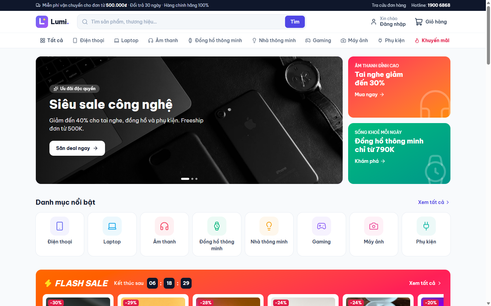
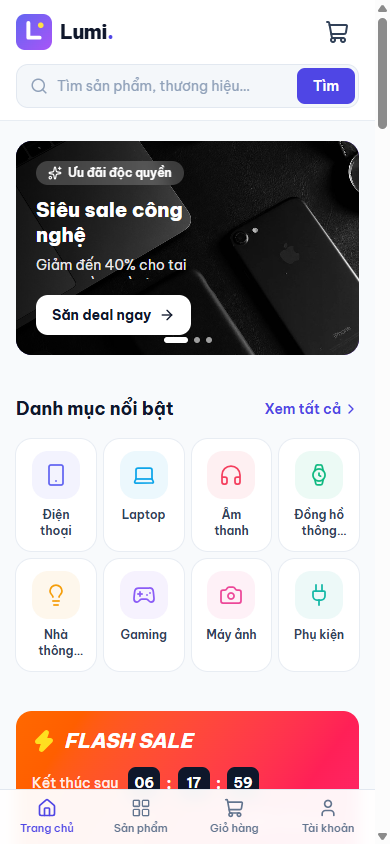
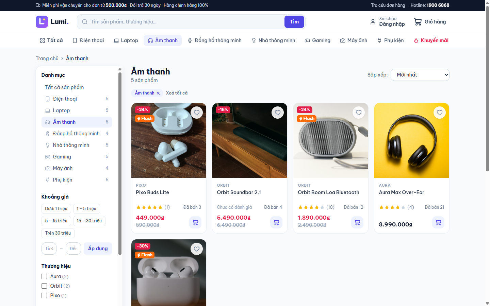
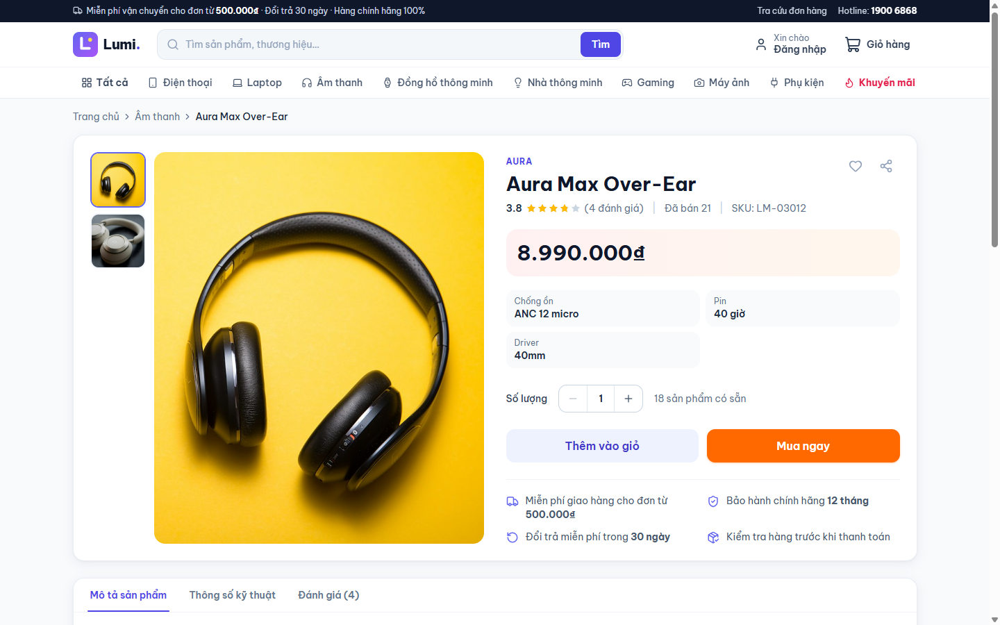
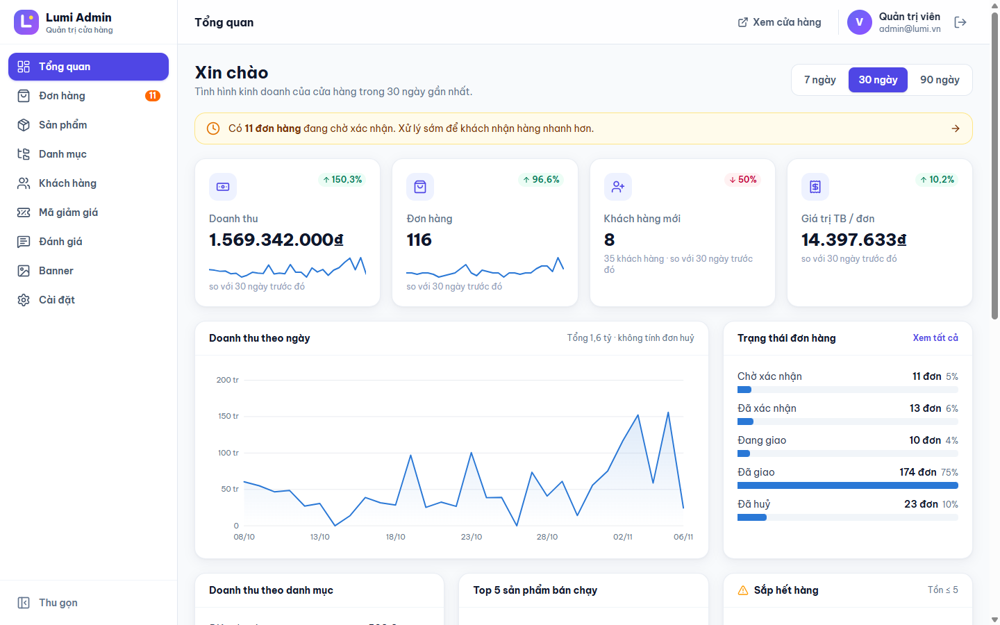
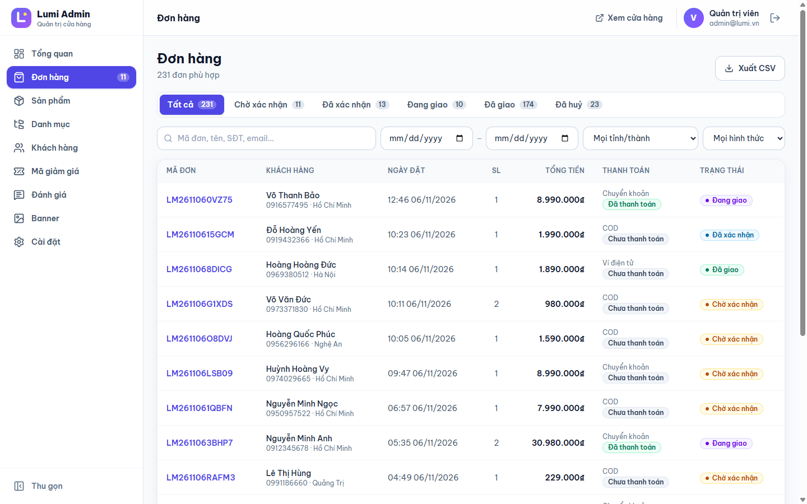
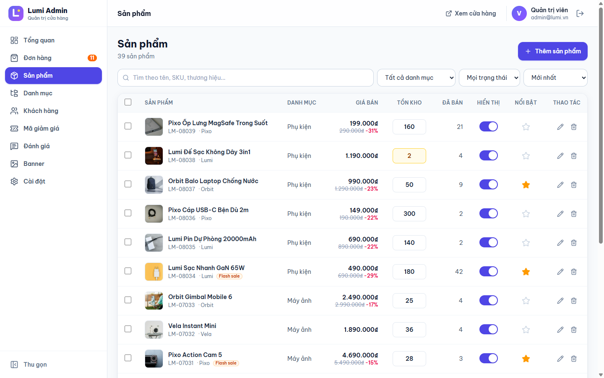

# Lumi Store 🛍️

Website bán hàng hoàn chỉnh: **cửa hàng** + **trang quản trị** + **REST API**.
Đặc tả chi tiết: [SPEC.md](SPEC.md).

## Giao diện

| Trang chủ | Trên điện thoại |
|---|---|
|  |  |

| Danh sách sản phẩm | Chi tiết sản phẩm |
|---|---|
|  |  |

| Quản trị: tổng quan | Quản trị: đơn hàng |
|---|---|
|  |  |



| Phần | Công nghệ |
|---|---|
| Frontend | React 18, Vite 6, Tailwind CSS 4, React Router, lucide-react |
| Backend | Node.js 20, Express 5, SQLite (better-sqlite3), JWT, Zod, Multer |

## Chạy thử

Cần Node.js 20 trở lên.

```bash
cd shop
npm run setup      # cài thư viện cho server và client (lần đầu)
npm run dev        # chạy API (cổng 4000) + giao diện (cổng 5173)
```

- Cửa hàng: http://localhost:5173
- Quản trị: http://localhost:5173/admin

Lần chạy đầu tiên, dữ liệu mẫu được tạo tự động (39 sản phẩm, 35 khách hàng, ~230 đơn trong 90 ngày, đánh giá, mã giảm giá).

| Tài khoản | Email | Mật khẩu |
|---|---|---|
| Quản trị viên | admin@lumi.vn | admin123 |
| Khách hàng | khach@lumi.vn | 123456 |

Mã giảm giá mẫu: `CHAOBAN50K`, `LUMI10`, `FREESHIP`, `SIEUSALE`.

## Lệnh khác

```bash
npm run seed    # xoá và tạo lại dữ liệu mẫu
npm test        # chạy 11 bài test API
npm start       # build giao diện, chạy mọi thứ ở 1 cổng: http://localhost:4000
```

Biến môi trường (tuỳ chọn) cho server: `PORT`, `JWT_SECRET` (**bắt buộc đổi khi chạy thật**), `DB_FILE`, `NODE_ENV=production` (ẩn link đặt lại mật khẩu dùng cho demo).

## Cấu trúc

```
shop/
├── server/                 REST API
│   ├── src/routes/         catalog, auth, me (tài khoản), orders, admin
│   ├── src/services/       pricing.js – tính giá, mã giảm giá, phí ship
│   ├── src/seed.js         dữ liệu mẫu + ảnh minh hoạ SVG
│   └── test/api.test.js    test tích hợp
└── client/                 React app
    └── src/
        ├── pages/store/    trang chủ, sản phẩm, giỏ hàng, thanh toán, tra cứu…
        ├── pages/account/  tài khoản khách hàng
        ├── pages/admin/    13 trang quản trị
        └── components/     UI dùng chung, store, admin (biểu đồ SVG)
```

## Điểm nổi bật

- **Mua không cần tài khoản**, tra cứu đơn bằng mã đơn + SĐT.
- **VietQR**: sau khi đặt, khách quét mã với số tiền và nội dung điền sẵn.
- **Địa chỉ theo 34 tỉnh/thành mới** (Tỉnh → Phường/Xã), không còn quận/huyện.
- **Tìm kiếm không dấu** + gợi ý tức thì + phím tắt `/`.
- **Không bán quá tồn kho**: trừ kho trong transaction; huỷ đơn tự hoàn kho.
- Admin: dashboard có biểu đồ, sửa tồn kho ngay trên bảng, thao tác hàng loạt, xuất CSV, in đơn.

## Giới hạn của bản demo

- Chưa nối cổng thanh toán thật (ví điện tử là mô phỏng; VietQR chỉ tạo mã, admin tự xác nhận đã nhận tiền).
- Chưa gửi email thật: link đặt lại mật khẩu hiện ngay trên màn hình khi không chạy ở chế độ production.
- Ảnh sản phẩm mẫu là ảnh minh hoạ miễn phí từ [Unsplash](https://unsplash.com) (nguồn và tác giả từng ảnh: `server/seed-images/credits-*.json`); thương hiệu sản phẩm là hư cấu. Admin có thể tải ảnh thật lên.
